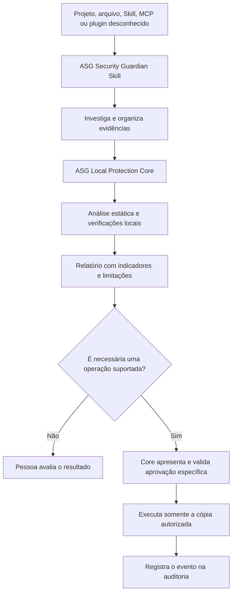

# ASG Security Guardian

O **ASG Security Guardian** é um projeto que estou desenvolvendo para ajudar a analisar arquivos, projetos, Skills, integrações MCP, plugins e outros conteúdos antes de confiar neles ou utilizá-los.

A ideia é simples: antes de executar ou instalar algo que veio de uma fonte desconhecida, quero ter uma visão melhor do que existe ali, quais sinais merecem atenção e quais cuidados devo tomar.

> **Situação atual: protótipo experimental — MVP 0.2.1.** O ASG ainda não é um antivírus, EDR ou solução completa de proteção de computadores. Um relatório sem alertas não garante que um arquivo ou projeto seja seguro.

## O que está publicado

Este repositório agora contém o código do MVP, a Skill para Claude Code, o Protection Core local, a política de segurança, os instaladores, os testes e a documentação.

- **ASG Security Guardian Skill:** conduz a investigação, organiza evidências e explica os resultados.
- **ASG Local Protection Core:** executa verificações estáticas locais, mantém baselines de integridade, controla aprovações específicas e registra eventos de auditoria.

A Skill não é, sozinha, uma barreira de segurança. A validação das operações suportadas é feita pelo Core. O projeto não executa o conteúdo analisado.

## Recursos do MVP 0.2.1

- Inventário de arquivos e hashes SHA-256.
- Indicadores heurísticos para execução dinâmica, processos, rede, persistência, privilégios, ofuscação, prompt injection e possíveis segredos.
- Redação de valores de segredos identificados nos relatórios, inclusive quando outra regra aponta a mesma linha.
- Inspeção limitada de metadados ZIP, sem extração.
- Relatórios em JSON e Markdown.
- Baseline e comparação de integridade para arquivos adicionados, modificados e removidos.
- Monitoramento por polling, somente para detecção; não bloqueia alterações.
- Aprovação individual, de uso único, vinculada à ação, ao alvo e ao hash, com validade de 15 minutos.
- Quarentena por cópia, com verificação do hash e preservação do original.
- Auditoria local JSONL com encadeamento SHA-256. É tamper-evident, não imutável contra administrador local.
- Configuração local por padrão: sem upload para nuvem, sem acesso remoto de inteligência de ameaças e sem execução de código não confiável.

## Como funciona



**Regra principal:** o ASG investiga e explica; a pessoa decide; o Core valida e registra somente as operações que estão implementadas.

## Requisitos

- Python 3.10 ou superior.
- Windows, Linux ou macOS para os componentes Python; os instaladores são específicos de cada sistema.
- Claude Code com suporte a Skills personalizadas para utilizar a Skill.
- `pytest` somente para executar a suíte de testes.

O Core não depende de bibliotecas Python de terceiros para as operações descritas no MVP.

## Instalação

Baixe ou clone o repositório e execute o instalador a partir da pasta do projeto.

### Windows PowerShell

```powershell
Set-ExecutionPolicy -Scope Process -ExecutionPolicy Bypass
.\install.ps1
```

Para instalar a Skill somente no projeto atual:

```powershell
.\install.ps1 -Project
```

### Linux / macOS

```bash
chmod +x ./install.sh
./install.sh
```

Para instalar a Skill somente no projeto atual:

```bash
./install.sh --project
```

Os instaladores copiam a Skill e o Core para a pasta local do usuário e criam um launcher. Eles não instalam serviços, drivers, não alteram o firewall e não executam o conteúdo analisado. A instalação interrompe se encontrar um destino já existente; faça backup e remova ou mova a instalação anterior manualmente antes de reinstalar.

Consulte [INSTALL.md](INSTALL.md) para detalhes e desinstalação.

## Uso

### Análise estática

Windows:

```powershell
py -3 protection_core/asg_guard.py "C:\caminho\do\projeto" --out ".\asg-reports"
```

Linux / macOS:

```bash
python3 protection_core/asg_guard.py "/caminho/do/projeto" --out ./asg-reports
```

### Protection Core local

```bash
python3 protection_core/asg_local.py --help
python3 protection_core/asg_local.py baseline /caminho/do/projeto
python3 protection_core/asg_local.py check /caminho/do/projeto
python3 protection_core/asg_local.py watch /caminho/do/projeto --interval 10
python3 protection_core/asg_local.py propose-quarantine /caminho/do/arquivo-suspeito
python3 protection_core/asg_local.py approve REQUEST_ID
python3 protection_core/asg_local.py verify-audit
```

No Windows, use `py -3` no lugar de `python3`, quando necessário. O estado local padrão fica em `~/.asg-security-guardian`.

A quarentena exige terminal interativo e confirmação digitada exatamente como `APPROVE REQUEST_ID`. Ela cria uma cópia; não move, apaga nem neutraliza o original.

## Testes

```bash
python -m pip install pytest
python -m pytest -q
```

A suíte atual usa fixtures sintéticas. Os testes não são uma auditoria independente e não medem a taxa de detecção de malware. O workflow do GitHub Actions está configurado para Windows, Linux e macOS, com Python 3.10 a 3.13; os resultados precisam ser acompanhados na aba Actions após cada publicação.

## Limitações importantes

- Heurísticas podem gerar falsos positivos e falsos negativos; um indicador não confirma malware.
- Não há análise completa de AST, taint ou fluxo de dados.
- Não há SCA, SBOM ou verificação completa de procedência.
- ZIP é inspecionado apenas por metadados; não há extração nem análise profunda de arquivos aninhados.
- Não há engenharia reversa completa de PE/ELF/Mach-O.
- Não há monitoramento em tempo real de processos, kernel ou rede.
- Não há firewall, sandbox, bloqueio de processos ou monitoramento de credenciais.
- Baseline e polling detectam mudanças, mas não impedem alterações.
- O ledger é tamper-evident, não imutável contra administrador local privilegiado.
- Um resultado sem alertas significa apenas que os verificadores implementados não encontraram os indicadores procurados naquela análise.

Consulte [docs/ARQUITETURA.md](docs/ARQUITETURA.md), [docs/COMO-USAR.md](docs/COMO-USAR.md), [docs/ARCHITECTURE.md](docs/ARCHITECTURE.md), [docs/LOCAL_CORE_0.2.md](docs/LOCAL_CORE_0.2.md) e [SECURITY.md](SECURITY.md).

## Contribuições e versão oficial

Qualquer pessoa pode fazer fork, baixar o código, criar sua própria versão e propor melhorias por Pull Request. As mudanças só entram na versão oficial depois de revisão e aprovação do mantenedor. Consulte [CONTRIBUTING.md](CONTRIBUTING.md).

## Licença

O projeto é distribuído sob a **MIT License**. É permitido usar, copiar, modificar e distribuir o software, inclusive comercialmente, desde que o aviso de copyright e o texto da licença sejam mantidos. Consulte [LICENSE](LICENSE).
