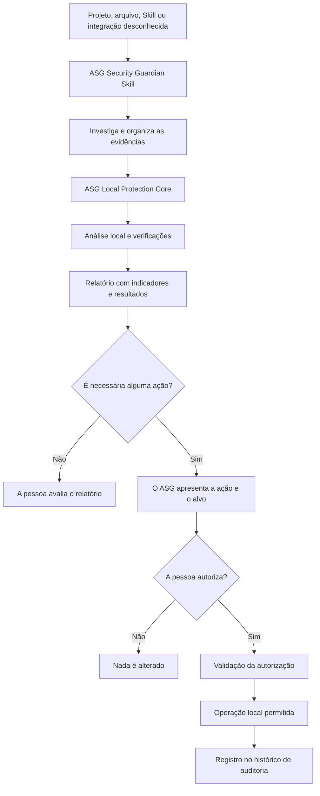
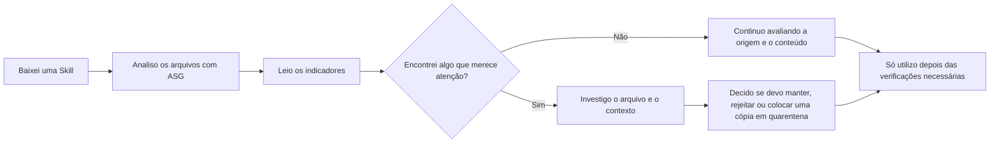

# ASG Security Guardian

O **ASG Security Guardian** é um projeto que estou desenvolvendo para ajudar a analisar arquivos, projetos, Skills, integrações MCP, plugins e outros conteúdos antes de confiar neles ou utilizá-los.

A ideia é simples: antes de executar ou instalar algo que veio de uma fonte desconhecida, quero ter uma visão melhor do que existe ali, quais sinais merecem atenção e quais cuidados devo tomar.

O ASG foi pensado para trabalhar localmente, com análise inicialmente somente de leitura e sem tomar decisões importantes no lugar da pessoa.

> **Situação atual: protótipo experimental — MVP 0.2.** O ASG ainda não é um antivírus, EDR ou solução completa de proteção de computadores. Um relatório sem alertas não garante que um arquivo ou projeto seja seguro.

## Por que criei este projeto

Projetos e ferramentas baixados da internet podem trazer arquivos suspeitos, configurações inseguras, códigos difíceis de entender ou instruções que tentam influenciar o comportamento de agentes de IA.

Quero que o ASG ajude a investigar esse tipo de conteúdo antes que ele seja utilizado. Em vez de executar automaticamente o que encontrar, a proposta é reunir evidências, explicar os possíveis riscos e deixar qualquer ação sob controle da pessoa responsável.

## Como o ASG é organizado

O projeto foi pensado em duas partes que trabalham juntas:

### 1. ASG Security Guardian Skill

É a parte que conduz a investigação. Ela organiza a análise, ajuda a interpretar os resultados e explica o que merece atenção. Também deve pedir autorização antes de propor uma ação que altere arquivos.

### 2. ASG Local Protection Core

É a parte responsável pelas verificações locais. Ela reúne utilitários para analisar arquivos, comparar alterações, controlar aprovações específicas, criar cópias em quarentena e registrar o histórico das operações.

A Skill não é, sozinha, uma barreira de segurança. As verificações e os controles do Protection Core é que devem validar as operações suportadas.

## Como funciona

O fluxo foi pensado para que a análise aconteça antes de qualquer ação:

A regra principal é: **o ASG investiga e explica; a pessoa decide; o Core valida e registra as operações que estão implementadas.**

## O que o MVP 0.2 contempla

- **Inventário de arquivos:** lista os arquivos encontrados e calcula o hash SHA-256.
- **Indicadores heurísticos:** procura sinais relacionados a execução de processos, acesso à rede, persistência, privilégios, ofuscação, possíveis segredos e instruções suspeitas direcionadas a agentes.
- **Proteção de informações sensíveis:** oculta valores de segredos nos relatórios, quando identificados pelos verificadores.
- **Verificação limitada de ZIP:** examina metadados do arquivo compactado. Nesta versão, não extrai o conteúdo.
- **Baseline de integridade:** registra uma referência dos arquivos para permitir comparações posteriores.
- **Comparação de alterações:** identifica arquivos adicionados, modificados ou removidos em verificações posteriores.
- **Aprovação controlada:** a autorização é vinculada à ação, ao alvo e ao hash exatos, é de uso único e expira após 15 minutos.
- **Quarentena por cópia:** permite criar uma cópia de um arquivo para análise isolada. O arquivo original não é removido nem alterado por essa operação.
- **Histórico local:** registra eventos em JSONL com encadeamento de hashes e permite verificar a integridade dessa sequência.
- **Funcionamento local por padrão:** o desenho atual não prevê envio de arquivos para a nuvem nem consultas remotas a serviços de inteligência de ameaças.

## Como tirar melhor proveito do ASG

Minha recomendação é usar o ASG como uma etapa de verificação antes de confiar em qualquer conteúdo desconhecido.

1. **Separe o material para análise.** Guarde o projeto ou arquivo em uma pasta própria. Não execute o conteúdo só para descobrir o que ele faz.
2. **Faça uma análise inicial.** Use a verificação estática para levantar os arquivos e os indicadores encontrados.
3. **Leia o resultado com atenção.** Um indicador é um sinal para investigar, não uma prova automática de que existe malware.
4. **Crie uma referência de integridade.** Quando estiver trabalhando com uma pasta que você considera confiável naquele momento, registre um baseline.
5. **Compare as alterações.** Faça novas verificações para identificar o que foi adicionado, modificado ou removido.
6. **Avalie antes de agir.** Se uma operação suportada for necessária, confira o alvo, a ação e o hash apresentados.
7. **Autorize somente o que fizer sentido.** A aprovação é específica, de uso único e tem prazo limitado.
8. **Confira o histórico.** Use a verificação da auditoria para verificar a integridade dos registros locais.

### Exemplo de uso

Imagine que você baixou uma Skill de um repositório que ainda não conhece.

O ASG ajuda nessa avaliação, mas não substitui a revisão humana, a confiança na origem do material ou outras ferramentas de segurança.

## O que o ASG não faz nesta versão

É importante deixar claro o que o projeto ainda não oferece:

- Não é antivírus e não garante a detecção de todo tipo de ameaça.
- Não executa uma análise completa de código, como AST, taint analysis ou análise de fluxo de dados.
- Não faz uma análise completa de dependências, SBOM, procedência ou VEX.
- Não extrai ZIPs nem faz uma análise profunda de arquivos compactados aninhados.
- Não faz engenharia reversa completa de executáveis PE, ELF ou Mach-O.
- Não monitora processos, kernel ou tráfego de rede em tempo real.
- Não aplica regras de firewall, não cria sandbox e não impede alterações detectadas pelo monitoramento por comparação.
- A quarentena cria uma cópia; não desativa, apaga ou neutraliza o arquivo original.
- O histórico com encadeamento de hashes ajuda a perceber alterações, mas não é imutável contra alguém com privilégios administrativos na máquina.

Por isso, um resultado sem alertas deve ser entendido apenas como: **nenhum dos indicadores implementados foi identificado naquela análise**.

## Requisitos e plataformas previstas

O desenho atual considera Python 3.10 ou superior e Windows, Linux e macOS como plataformas-alvo. Sensores nativos de endpoint ainda não fazem parte do MVP descrito aqui.

A integração da Skill foi pensada para ambientes compatíveis com Skills personalizadas, como Claude Code. O funcionamento e a disponibilidade dependem do ambiente em que o projeto for instalado.

## Situação deste repositório

Estou organizando o projeto e sua documentação por etapas. **Neste momento, a versão publicada neste repositório contém o README e a licença.** Os scripts do Protection Core, a Skill, os instaladores e a suíte de testes ainda precisam ser adicionados ao repositório antes que seja possível seguir as instruções de instalação e execução.

Assim que esses arquivos forem publicados e testados, esta documentação poderá incluir os comandos definitivos de instalação e uso. Não considere o repositório atual como um pacote instalável completo.

## Próximos passos do projeto

1. Publicar e testar os arquivos da Skill e do Protection Core.
2. Reforçar os verificadores e cobrir casos de borda dos arquivos analisados.
3. Adicionar integrações testadas para SAST, análise de dependências, SBOM, procedência e VEX.
4. Criar regras de detecção versionadas e assinadas.
5. Desenvolver trabalhadores de análise isolados (sandbox).
6. Evoluir os controles de rede e a observabilidade de acesso a credenciais.
7. Melhorar a interface de aprovação e o mecanismo de políticas.
8. Desenvolver recursos de resposta a incidentes e recuperação verificada.
9. Submeter o projeto a testes independentes de segurança e avaliação de falsos negativos.

## Como contribuir

Quero que as contribuições venham acompanhadas de testes, explicação das hipóteses de ameaça e respeito aos limites de segurança do projeto.

Não envie malware real, credenciais, chaves privadas ou dados pessoais para os repositórios e exemplos.

## Licença

O projeto é distribuído sob a licença **MIT**. Isso permite usar, copiar, modificar e distribuir o software, inclusive em projetos comerciais, desde que o aviso de copyright e a licença sejam mantidos nas cópias ou em partes substanciais do software.

Consulte o arquivo [LICENSE](LICENSE) para ver os termos completos.
