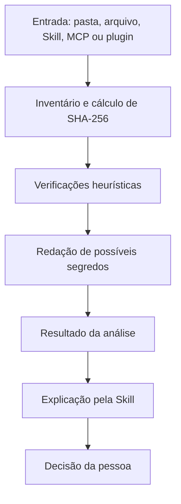
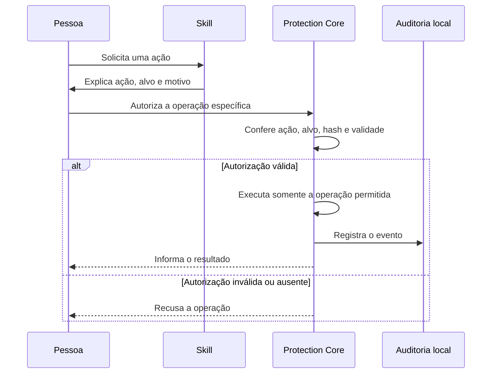

# Como o ASG funciona

Este documento explica a organização prevista para o ASG Security Guardian usando uma linguagem direta. O projeto está em fase experimental; os diagramas representam a arquitetura descrita para o MVP 0.2 e não significam que todos os componentes já estejam publicados neste repositório.

## Visão geral

O ASG foi dividido em duas partes:

- **Security Guardian Skill:** conduz a investigação, organiza as evidências e explica os resultados.
- **Local Protection Core:** executa as verificações locais e controla as operações suportadas.

A Skill não deve ser tratada como uma barreira de segurança por si só. A validação de ações precisa acontecer no Core, com regras determinísticas e autorização explícita.

## Caminho da análise

## Caminho de uma operação autorizada

A autorização descrita no MVP é de uso único, vinculada à ação, ao alvo e ao hash exatos, e expira após 15 minutos.

## Componentes e responsabilidades

| Parte | Responsabilidade |
|---|---|
| Inventário | Identificar arquivos e calcular hashes SHA-256 |
| Verificadores heurísticos | Apontar sinais que merecem investigação |
| Redação de segredos | Evitar expor valores identificados nos relatórios |
| Baseline | Guardar uma referência de integridade |
| Comparação | Apontar arquivos adicionados, modificados ou removidos |
| Aprovação | Validar uma autorização específica antes da operação |
| Quarentena por cópia | Criar uma cópia sem alterar o original |
| Auditoria | Registrar eventos localmente e verificar a cadeia de hashes |

## Como interpretar os resultados

Um indicador heurístico não confirma que um arquivo é malicioso. Ele aponta um comportamento ou conteúdo que merece revisão. Da mesma forma, a ausência de indicadores não prova que o arquivo é seguro.

O histórico encadeado por hashes é útil para identificar alterações na sequência de registros, mas não é inviolável contra um administrador local com controle da máquina.
