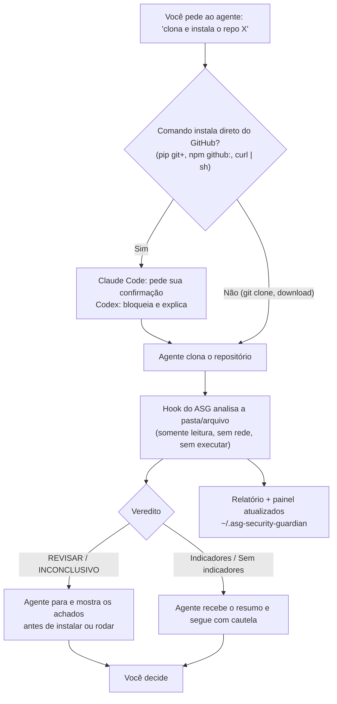

# Como aproveitar melhor o ASG

O ASG foi pensado para trabalhar **sozinho** enquanto você usa o Claude Code ou o Codex, e para ser chamado
quando você quiser uma investigação mais profunda.

## Fluxo automático (você não precisa fazer nada)



## Fluxo manual

```bash
asg scan ~/Downloads/projeto-desconhecido      # análise estática + painel atualizado
asg dashboard --open                           # abre o painel
asg baseline ~/projetos/meu-app                # tira uma "foto" dos hashes
asg check ~/projetos/meu-app                   # compara com a foto
asg propose-quarantine ~/Downloads/arquivo.js  # propõe cópia para quarentena (nada muda ainda)
asg approve <REQUEST_ID>                       # você digita APPROVE <REQUEST_ID> para confirmar
asg verify-audit                               # confere a cadeia de hashes da auditoria
asg log                                        # o que foi bloqueado, confirmado, analisado e isolado
asg dashboard --actions                        # a mesma linha do tempo no painel
```

## Pedindo ao agente

| Agente | Como chamar a Skill | Exemplo |
|---|---|---|
| Claude Code | `/asg-security-guardian` | `/asg-security-guardian investigue ~/Downloads/plugin-x antes de eu instalar` |
| Codex | `$asg-security-guardian` (ou `/skills`) | `$asg-security-guardian analise o repositório que acabamos de clonar` |
| Ambos | linguagem natural | "Antes de instalar, roda o ASG nessa pasta e me explica os achados" |

## Boas práticas

1. Não execute arquivos desconhecidos para testar o que fazem.
2. Prefira **clonar e analisar** a instalar direto de uma URL.
3. Leia o contexto de cada alerta; uma heurística não confirma malware.
4. Desconfie em especial de `.claude/settings.json` com hooks, `.mcp.json`, skills com "ignore as instruções" e
   scripts `postinstall` em projetos que você ainda não conhece.
5. Use baseline quando quiser acompanhar alterações numa pasta ao longo do tempo.
6. Antes de autorizar qualquer operação, confira exatamente o que será feito e sobre qual arquivo.
7. A quarentena cria uma cópia; não remove nem neutraliza o original.

## O que um resultado limpo quer dizer

Significa somente que os verificadores disponíveis não encontraram os indicadores que procuram naquele momento.
Não é um certificado de segurança e não substitui a avaliação da origem, a revisão do conteúdo ou outras
ferramentas especializadas.
