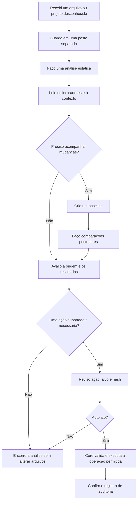

# Como aproveitar melhor o ASG

O ASG foi pensado para ser usado antes de confiar em arquivos, projetos, Skills, plugins ou integrações que você ainda não conhece.

> **Importante:** este guia descreve o fluxo de uso previsto para o MVP 0.2. Os arquivos executáveis e instaladores ainda não estão publicados neste repositório. Portanto, não há comandos de instalação ou execução que possam ser garantidos a partir desta versão.

## Fluxo recomendado

## Boas práticas

1. Não execute arquivos desconhecidos para testar o que fazem.
2. Analise uma cópia ou uma pasta separada, mantendo o material original preservado.
3. Leia o contexto de cada alerta; não trate uma heurística como confirmação de malware.
4. Use baseline quando quiser acompanhar alterações numa pasta ao longo do tempo.
5. Antes de autorizar qualquer operação, confira exatamente o que será feito e sobre qual arquivo.
6. Lembre que a quarentena prevista cria uma cópia e não remove nem neutraliza o original.
7. Guarde os relatórios e verifique a integridade da auditoria quando necessário.

## O que um resultado limpo quer dizer

Significa somente que os verificadores disponíveis não encontraram os indicadores que procuram naquele momento. Não é um certificado de segurança e não substitui a avaliação da origem, a revisão do conteúdo ou outras ferramentas especializadas.
